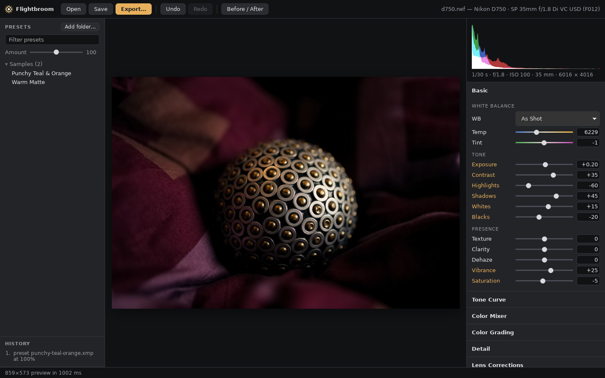

# Ambrotype

A free, open-source alternative to Adobe Lightroom® for Windows, macOS and Linux that can apply the Lightroom presets you already bought, faithfully.



**Status:** early. The scoping is done. Working so far: the preset reader, the Lightroom calibration kit, a raw renderer covering the core of Lightroom's Develop panels (white balance, camera colour, Basic tone/presence incl. Texture/Clarity/Dehaze, HSL, Color Grading, curves, sharpening, noise reduction, Lens Corrections, post-crop vignette, grain), film negative conversion with film stock looks, export to JPEG/PNG/TIFF/WebP/AVIF/OpenEXR with colour-managed output, and a command protocol so scripts and AI assistants can drive edits. An early desktop editor (`amb-gui`, Tauri 2) opens a raw, edits it with sliders, curves, colour wheels and presets, with 1:1 zoom, a white-balance picker and clipping overlay, and exports; the `amb` command-line tool does everything else (see docs/ARCHITECTURE.md).

## Docs
- [docs/SCOPE.md](docs/SCOPE.md): the project scope, strategy, roadmap, risks and open decisions. Start here.
- [docs/ARCHITECTURE.md](docs/ARCHITECTURE.md): how the program is built today (crates, data flow, export, the desktop editor).
- [docs/GAPS.md](docs/GAPS.md): every known gap, guess and open question, for future refinement, with a top 10. Ideas for later (Auto, Randomize, Tutorial mode): [docs/design/future-ideas.md](docs/design/future-ideas.md).
- [docs/NEXT.md](docs/NEXT.md): where we left off and what to do next.
- [docs/research/](docs/research/): research on Lightroom's features, preset and profile formats, darktable, RawTherapee and the OSS ecosystem, processing algorithms, tech stack, RapidRAW, cross-platform concerns, the commercial market, and a reading list.
- [docs/adobe-docs/](docs/adobe-docs/): source-only digests of Adobe's official Lightroom and Camera Raw help.
- [docs/legal-and-naming.md](docs/legal-and-naming.md): legal position (docs, formats, black-box testing, trademarks) and the product-name shortlist.
- [docs/desktop-setup.md](docs/desktop-setup.md): build and run it on your machine.
- [docs/lightroom-trial-plan.md](docs/lightroom-trial-plan.md) and [docs/sources-to-collect.md](docs/sources-to-collect.md): what to gather next.
- [docs/design/lens-corrections.md](docs/design/lens-corrections.md) and [docs/design/film-negatives.md](docs/design/film-negatives.md): Lens Corrections, and film negative conversion with film stock looks.
- [docs/design/ai-control.md](docs/design/ai-control.md) and [docs/ai/](docs/ai/): bring-your-own-AI control, the AI guide and the generated settings reference ([llms.txt](llms.txt)).
- [docs/design/customization-and-hub.md](docs/design/customization-and-hub.md) and [docs/design/collage-and-borders.md](docs/design/collage-and-borders.md): shareable layouts, themes, the hub, plugins and AI-made features; borders and the collage maker (planned).
- [AGENTS.md](AGENTS.md): notes for AI coding agents working on the repo.
- [hub/](hub/README.md): the template for the looks hub repo (shared layouts and themes, submitted as pull requests).

## Code (Rust workspace)

| Crate | What it does |
|---|---|
| `crates/amb-presets` | Reads Lightroom/Camera Raw `.xmp` presets, XMP sidecars, legacy `.lrtemplate` presets, and XMP embedded in DNG/JPEG "presets" into a lossless settings model. Includes a tag registry (`data/tags.json`), per-preset inspection/fidelity reports, and provisional Amount scaling. |
| `crates/amb-engine` | Processing engine v0, a staged pipeline over linear ProPhoto: raw decode (rawler), white balance, Exposure, Dehaze (dark-channel prior), Basic tone (global v1), Texture/Clarity (edge-aware local contrast), Vibrance/Saturation, 8-band HSL, Color Grading, parametric and point curves, noise-adaptive luminance and colour NR, sharpening with Detail and Masking, Lens Corrections (profile distortion/vignetting/CA, auto CA removal, manual distortion and lens vignetting, defringe, constrain crop), post-crop vignette (3 styles), resolution-independent grain, and sRGB output. All model constants are fit-ready (`--calibration`). |
| `crates/amb-lens` | Lens profiles: reads the lensfun database and the Adobe `.lcp` files you already have (in place, never copied), matches camera + lens from raw metadata, interpolates to the shot's focal length/aperture/distance, and evaluates the correction geometry. |
| `crates/amb-export` | Export: JPEG (quality, subsampling, size limit), PNG 8/16, TIFF 8/16/32f, WebP, AVIF, OpenEXR; sRGB/Display P3/Adobe RGB-compatible/ProPhoto/Rec. 2020 with generated ICC profiles; resize to fit, output sharpening, EXIF with privacy options; rotated upright. |
| `crates/amb-protocol` | Typed, undoable edit commands and queries validated against the settings registry (`amb edit`, `amb query`, `amb protocol schema`), plus the AI-readable settings reference (`docs/ai/`). |
| `crates/amb-color` | Colour science: Lightroom-style Temperature/Tint ↔ CIE xy (Robertson's method). |
| `crates/amb-testkit` | Calibration tooling: synthetic DNG targets (ramp, hue grid, edges, ColorChecker) and the Lightroom slider-sweep kit (raw copies + XMP sidecars, or DNGs with embedded settings, + manifest). |
| `crates/amb-gui` | The desktop editor (Tauri 2): open a raw, Lightroom-like panels generated from the settings registry, presets with Amount, before/after, history, undo/redo, sidecar save, export dialog. Run: `cargo run --release -p amb-gui -- photo.nef` (Linux needs the WebKitGTK dev packages, see docs/desktop-setup.md). |
| `crates/amb-cli` | The `amb` command-line tool. |

```sh
cargo test
cargo run -p amb-cli -- preset inspect path/to/preset.xmp
cargo run -p amb-cli -- preset census ~/my-presets      # which settings your preset collection actually uses
cargo run -p amb-cli -- sweep plan                      # the Lightroom calibration sweeps
cargo run -p amb-cli -- testimage colorchecker cc.dng   # a synthetic linear DNG target
cargo run --release -p amb-cli -- render photo.nef out.jpg --preset look.xmp --amount 70
cargo run --release -p amb-cli -- render photo.nef web.jpg --long-edge 2048 --sharpen screen --max-size 1M
cargo run --release -p amb-cli -- render photo.nef print.tif --bits 16 --color-space adobergb   # also .png .webp .avif .exr
cargo run -p amb-cli -- lens info photo.nef             # which lens profile a raw gets (lensfun / your .lcp files)
cargo run -p amb-cli -- negative analyze scan*.nef --out roll.xmp   # film negatives: base/levels for a roll (docs/design/film-negatives.md)
```

All rendering models are first versions ("ours, not Adobe's"). Their constants are to be fitted against Lightroom renders (`amb calibration defaults` prints them). `amb render` lists which preset settings it doesn't render yet. Masks (linear, radial, brush, luminance and colour range) and spot removal (heal and clone) work in Lightroom's own format ([masks](docs/design/masks.md), [spots](docs/design/spot-removal.md)). Transform and Upright (Auto, Level, Vertical, Full) render too ([transform](docs/design/transform.md)). Next: built-in lens profiles from raw files, red eye, camera profiles (DCP), and the MCP server and look matching for AI control (SCOPE §8).

## Licence

Copyright © 2026 The Ambrotype contributors. Ambrotype is free software under the [GNU General Public License, version 3 or later](LICENSE): you may use, share and change it, and anything you distribute that is based on it must be under the same licence, with its source. It comes with no warranty.

The plugin SDK (`crates/amb-plugin-sdk`) and the `amb plugin new` template are MIT or Apache-2.0, so plugins can use any licence. Credits for code from other projects (the X-Trans demosaic comes from [darktable](https://www.darktable.org/)) and library notices are in [NOTICE](NOTICE). How to contribute: [CONTRIBUTING.md](CONTRIBUTING.md).

*Lightroom and Camera Raw are trademarks of Adobe Inc.; Fujifilm's film simulation names are trademarks of FUJIFILM Corporation. This project is not affiliated with or endorsed by either.*
