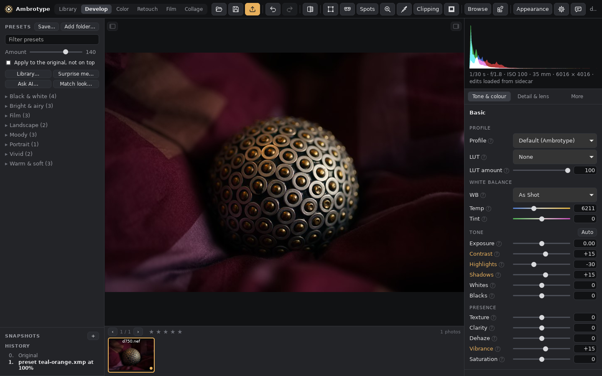

# Ambrotype

A free, open-source photo editor and organiser for Windows, macOS and Linux, in the spirit of Adobe Lightroom®. It opens your raws, edits them without touching the originals, and applies the Lightroom presets you already bought, faithfully.



<sub>Photo: a Nikon D750 sample raw from [raw.pixls.us](https://raw.pixls.us/), shared under CC0 (public domain).</sub>

**Status: early, and moving fast.** No installers are published yet: the first release (v0.1.0) will have them for Windows, macOS and Linux on the [Releases](https://github.com/shardpelt/Ambrotype/releases) page. Until then, build it from source (below). Expect rough edges, and please report them (the Feedback button in the app opens a pre-filled issue).

## What it does

- **Edits raws** (and JPEG, PNG, TIFF, WebP) with Lightroom's Develop panels: white balance, tone, presence, curves, colour mixer, colour grading, detail, lens corrections, transform and Upright, effects, calibration. Edits live in XMP sidecars that Lightroom can read too.
- **Film negatives:** colour and black-and-white negatives turned into positives, with a film base picker, Sync across a roll, a fixed range for frames that should print alike, cast removal along the greys, and an Expired film setting for faded rolls.
- **Local adjustments:** linear, radial and brush masks, luminance and colour ranges, Sky, and AI Subject, Background and People masks that run on your computer (pick the model in Settings → AI models).
- **Presets:** Lightroom `.xmp` and `.lrtemplate` presets with Amount, a preset library, Auto, Match look and Surprise me; save your own to any folder or share them to the hub.
- **Library:** folders (whole drives, also while unplugged), collections and smart collections, ratings, labels, flags, keywords, compare and survey views, a timeline and a map, a slideshow, import from a card, and moving from a Lightroom Classic catalogue.
- **Organise:** duplicates and bursts (keep the best), move, rename and sort into dated folders with sidecars kept together, delete to the trash, keywords and metadata templates, and finding photos moved outside the app.
- **Learn as you go:** a sample photo to step through, a **?** by every setting, Photography basics with tones lit up on your own photo, and short lessons.
- **More:** spot removal and a heal brush, HDR and panorama merges, LUTs, a collage maker, borders and frames, quick zoom and a loupe, soft proofing, monitor colour, copy a photo to the clipboard, export to JPEG, PNG, TIFF, WebP, AVIF, OpenEXR and JPEG XL with colour management.
- **Make it yours:** layouts and themes as small JSON files, shared through the [hub](https://github.com/Ambrotypehq/ambrotype-hub), and sandboxed plugins ([how](docs/make-it-yours.md)).
- **AI-friendly:** the `amb` command-line tool and an MCP server (`amb mcp`) let scripts and your own AI assistant make the same edits as the app.

All rendering models are our own ("ours, not Adobe's"): they're built by black-box measurement, never from Adobe's code or files. [docs/GAPS.md](docs/GAPS.md) lists everything that is still approximate or missing.

## Build and run

1. Install Rust from <https://rustup.rs>. Linux also needs the WebKitGTK development packages ([docs/desktop-setup.md](docs/desktop-setup.md) has the list per system).
2. Clone and run:
   ```sh
   git clone https://github.com/shardpelt/Ambrotype.git
   cd Ambrotype
   cargo run --release -p amb-gui -- photo.nef     # the editor (or leave out the photo and press Ctrl+O)
   cargo run --release -p amb-cli -- --help        # the amb command-line tool
   ```
3. Run the tests: `cargo test --workspace`.

## Code (Rust workspace)

| Crate | What it does |
|---|---|
| `amb-presets` | Reads Lightroom/Camera Raw presets and XMP sidecars into a lossless settings model; the tag registry (`data/tags.json`). |
| `amb-engine` | The raw pipeline over linear ProPhoto: decode, colour, tone, local contrast, colour grading, curves, detail, lens and geometry, masks, spots, effects, merges. |
| `amb-gpu` | The pipeline's stages as wgpu compute shaders for the editor's preview, each checked against its CPU stage. |
| `amb-protocol` | Typed, undoable edit commands. Every edit from the editor, the CLI or an AI goes through them. |
| `amb-export` | File writing, colour spaces with ICC profiles, resizing, sharpening, borders and watermarks. |
| `amb-library` | Folders and sidecars: the catalogue cache, import, collections, places from GPX tracks, duplicates, moving and renaming with companions, Lightroom catalogue import. |
| `amb-ai` | Local AI models for masks: the list of freely licensed models, the user's choice per task, and their own models. |
| `amb-lens` | Lens profiles from lensfun and the `.lcp` files you have. |
| `amb-color` | Colour science: Temperature/Tint, colour spaces, ICC profiles, monitor colour. |
| `amb-plugin`, `amb-plugin-sdk` | The WebAssembly plugin host, and the SDK plugins are written with (MIT OR Apache-2.0). |
| `amb-testkit` | Synthetic test photos and the Lightroom measuring kit. |
| `amb-gui` | The desktop editor (Tauri 2); its UI is plain HTML/CSS/JS in `crates/amb-gui/ui/`. |
| `amb-cli` | The `amb` command-line tool. |

## Docs

- [docs/NEXT.md](docs/NEXT.md): where the project is and what's next. **Start here.**
- [docs/ARCHITECTURE.md](docs/ARCHITECTURE.md): how it's built today.
- [docs/GAPS.md](docs/GAPS.md): every known gap, guess and open question.
- [docs/recipes.md](docs/recipes.md): step by step, what a common change touches.
- [docs/design/](docs/design/): one note per feature; [docs/ai/](docs/ai/): the guide for AI clients ([llms.txt](llms.txt)).
- [docs/make-it-yours.md](docs/make-it-yours.md): change the layout and colours, and share them through the hub (or your own).
- [docs/desktop-setup.md](docs/desktop-setup.md): building and running on each system, and a tour of the editor with its shortcuts.
- [docs/releasing.md](docs/releasing.md): how installers are built and released.
- [docs/lightroom-trial-plan.md](docs/lightroom-trial-plan.md): what to measure during a Lightroom trial; `tools/lightroom-kit/` builds the test photos.
- [docs/legal.md](docs/legal.md): the legal position (formats, black-box testing, trademarks, licences).
- [docs/SCOPE.md](docs/SCOPE.md) and [docs/research/](docs/research/): the original scoping and research.

## Contributing

Friends and strangers welcome. Read [CONTRIBUTING.md](CONTRIBUTING.md); [AGENTS.md](AGENTS.md) has the layout and conventions (for people and AI coding agents alike), and [docs/NEXT.md](docs/NEXT.md) has a Help wanted list.

## Licence

Copyright © 2026 The Ambrotype contributors. Ambrotype is free software under the [GNU General Public License, version 3 or later](LICENSE): you may use, share and change it, and anything you distribute that is based on it must be under the same licence, with its source. It comes with no warranty.

The plugin SDK (`crates/amb-plugin-sdk`) and the `amb plugin new` template are MIT or Apache-2.0, so plugins can use any licence. Credits for code from other projects (the X-Trans demosaic comes from [darktable](https://www.darktable.org/), the Bayer one is RCD as in RawTherapee and darktable) and library notices are in [NOTICE](NOTICE).

*Lightroom and Camera Raw are trademarks of Adobe Inc.; Fujifilm's film simulation names are trademarks of FUJIFILM Corporation; macOS is a trademark of Apple Inc. This project is not affiliated with or endorsed by any of them.*
