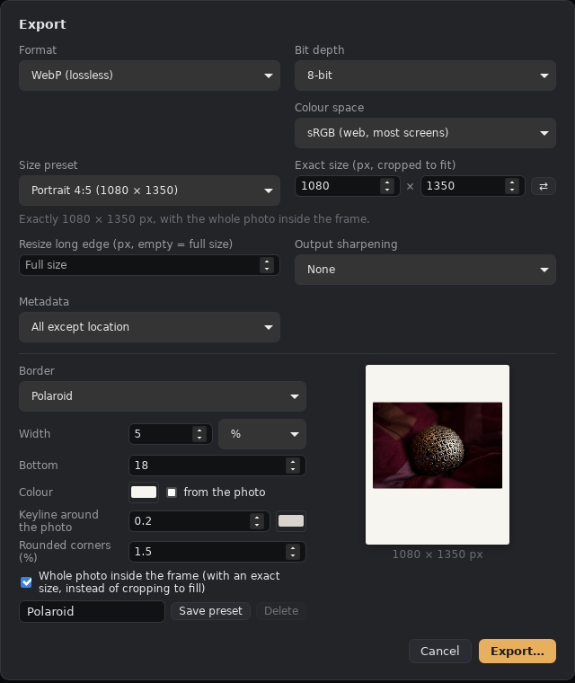

# Borders and the collage maker

Status: borders built (2026-10-08), the collage maker built (2026-10-08); open items are listed under each. Steps 5–6 of the UI track in [NEXT.md](../NEXT.md). Both use the size presets (Instagram, Snapchat, print, custom) from the crop tool.

## Borders

*Built (2026-10-08): `crates/amb-export/src/border.rs` (layout, colours, compositing), border presets in the export dialog (`ui/borders.js`, built-ins in `crates/amb-gui/data/border-presets.json`, yours in the settings file), `amb render --border 5%,#fff` or `--border preset.json`, and batches with `amb render A.nef B.nef … --out-dir DIR`. Captions and EXIF lines aren't built yet.*



A border is an export option, saved and shared as a **border preset**.

- **Settings:**
  - width as a percentage of the long or short edge, or in pixels; separate inner and outer widths
  - colour, or "sampled from the photo" (average or dominant colour)
  - corner radius
  - an optional caption or EXIF line (font, size, position, text template such as `{camera} · {focal} · f/{aperture} · {shutter}`)
- **Fit to a size preset:** for example "Instagram portrait 1080×1350 with a 4% white border". The photo is scaled to fit inside the border, and the rest is filled with the border colour. This gives the common "white frame around a landscape photo on a portrait post" look without cropping.
- **Where it applies:** in `amb-export`, after resize and output sharpening, so it is the same in the GUI, the CLI (`amb render --border preset.json`) and batch export.
- **Preview:** shown in the export dialog, and optionally in the viewer as a soft-proof overlay.

## Collage maker

*Built (2026-10-08):*
- *the layout format, compositing and page planner: `crates/amb-export/src/collage.rs`*
- *rendering one collage or a batch of pages, and the layouts list: `crates/amb-gui/src/collages.rs`; built-in layouts in `crates/amb-gui/data/collage-templates.json`, yours in the settings file*
- *the editor screen: `crates/amb-gui/ui/collage.js` (the Collage button, or C)*


How it works:
- **Photos** come from a tray under the canvas: the open photo's folder, plus any photos or folders you add. Drag one into a cell, or click it to fill the selected (or next empty) cell. **Fill empty cells** puts tray photos in order. The ⠿ grip swaps two cells.
- **In a cell:** drag to move the photo, scroll to zoom (around the pointer), double-click to fit again. **Rotate** (R) turns it a quarter; **Empty** (Delete) takes it out.
- **Edit photo** opens it in the editor with all its tools; **← Back to collage** returns, showing the new edit. The collage uses each photo's own edit (its sidecar), so there is one edit per photo, not one per collage.
- **The shape:** pick a layout, then split or remove cells. A built-in layout changes only the shape; your own layouts bring their size, gaps and background too.
- **Canvas:** size (any size preset, or your own width × height), background colour, gap between photos, outer border and rounded corners.
- **Export** renders every photo from its raw at the size its cell needs, composites in linear light and exports through `amb-export`. JPEG, PNG, TIFF, WebP or AVIF, in sRGB, Display P3 or Adobe RGB.
- **Batch** puts every tray photo (or only those with enough stars) into pages of the layout: `<layout name>-001.jpg`, `-002`, …. Landscape photos go to wide cells and portrait photos to tall cells where the layout has both; a short last page is filled in order.
- **Sharing:** Save layout keeps it in your list; Share… saves it as a small file (no photos); Import… adds one.

### Layout format (the shareable part)

```json
{ "format": "ambrotype-collage/1", "name": "Hero and two",
  "width": 1080, "height": 1350, "background": "#ffffff",
  "gap": 1.5, "margin": 3, "radius": 0,
  "cells": [ [0, 0, 1, 0.6], [0, 0.6, 0.5, 0.4], [0.5, 0.6, 0.5, 0.4] ] }
```

- `gap`, `margin` (the outer border) and `radius` are percentages of the canvas's short edge, so a layout looks the same at any size.
- A cell is `[x, y, width, height]` as fractions of the area inside the margin. Gaps are taken off the edges cells share, so neighbours stay `gap` apart. Up to 64 cells.
- **No photos:** layouts never contain photos, so they are small, private and shareable.
- **Built-ins:** two side by side or stacked, three columns or rows, grids 2 × 2 and 3 × 3, hero on top with two or three below, hero left with two right, big and three small, a mosaic of five, a film strip of four.

### Still to come

- Drag cell edges to resize neighbours together, merge cells, snap to thirds; round or polygon cells.
- Saving the collage itself (layout + photos + placements) to reopen and re-export later. Today it stays in place until the app closes.
- A per-cell edit separate from the photo's own (virtual copies), free rotation and flipping, per-cell borders and shadows.
- Batch: ordering by capture time, a page grid to swap photos between pages before exporting, running in the background, and shapes that follow a photo's crop (batch uses the camera preview's shape).
- The hub for collage layouts, and `amb collage render` in the CLI.

### Original plan (for reference)

#### Per photo on the canvas

- Each cell holds one photo and its **own develop edit**: the normal develop panels apply to the selected cell, using the same protocol commands. It's a virtual copy, so the photo's own sidecar is untouched.
- **Pan, zoom and rotate inside the cell** (cut is the cell mask), plus free rotation and flipping.
- Swap photos by dragging them between cells. Drop a folder on the canvas to fill the cells in order.
- An optional per-cell border and shadow.
- **The collage document** (template + photo paths + per-cell transforms and edits) is saved as its own small file next to the photos, so a collage can be reopened and re-exported.

#### Rendering and export

- Each cell is rendered by the engine at the size it needs on the final canvas (never upscaled from a preview), then composited.
- Export goes through `amb-export` (formats, colour spaces, sharpening, metadata).
- **CLI:** `amb collage render template.json photo1.nef photo2.nef … out.jpg`.

#### Batch mode (big folders)

- Choose a template and a folder: photos fill the cells N at a time, giving pages 1, 2, 3, ….
- **Order:** by capture time, by name, or "best first" once ratings exist.
- **Placement:** portrait and landscape photos go to cells of the matching orientation when the template has both; a face- or subject-aware default crop comes later, with masks.
- **Preview:** a page grid shows the result, where you can swap photos between pages before exporting.
- **Background job:** export runs as a background job with progress, and resumes if interrupted.
- The same batch idea applies to borders: "apply this border preset to every photo in the folder at Instagram portrait size".

## Open questions

- Text and stickers on the canvas: in scope for v1, or only the border caption?
- Templates with mixed cell sizes but a fixed aspect per cell (for example "always 4:5"), so batch-filled photos crop predictably.
- Print layouts (contact sheets, picture packages) overlap with Lightroom's Print module; decide whether this is the same feature.
