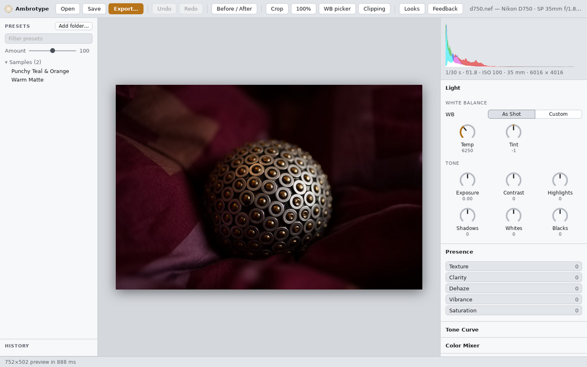
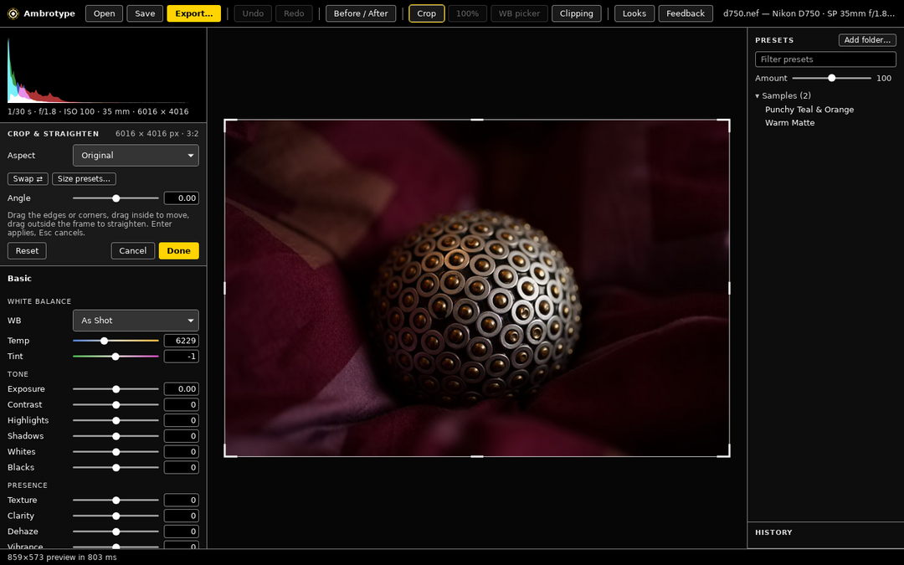
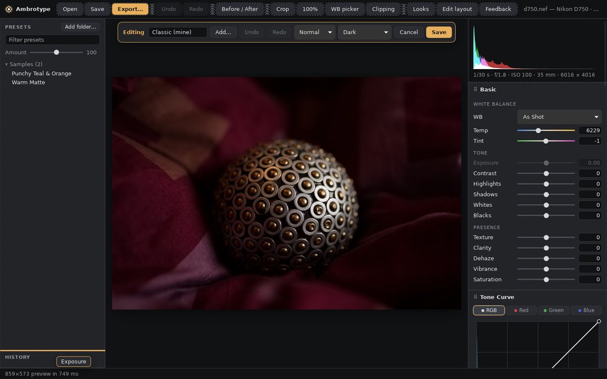
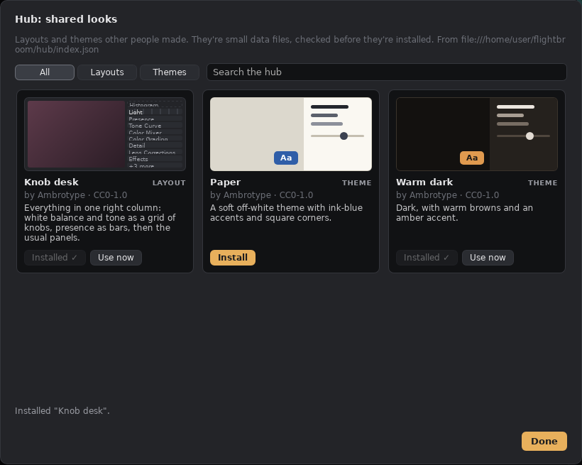

# Customisable UI, themes, the hub and AI-made features

Status: §1 layouts, the built-in looks and §2 themes are **built** (2026-10-07): `crates/amb-gui/src/looks.rs`, `ui/layout.js`, `ui/controls.js`, built-ins in `crates/amb-gui/data/hub/looks/`, a copy of the hub's (since 2026-10-15 the hub is where they are edited; `tools/sync-hub.py` copies the items listed in `data/hub/bundle.txt`). The format reference for people and AI assistants is [docs/ai/ui-layouts.md](../ai/ui-layouts.md). Editor mode (§3) and the hub (§4) are **built** too (`ui/editor.js`; `src/hub.rs`, `ui/hub.js`, and the [hub repo](https://github.com/Ambrotypehq/ambrotype-hub)). Plugins (§5) and the AI flows (§6) are next (UI track step 7 in [NEXT.md](../NEXT.md)).





## The idea in one line

Everything a user can make and share is a small file: a **layout**, a **theme**, a **preset pack**, a **collage template** ([collage-and-borders.md](collage-and-borders.md)), a **size profile**, a **border**, a **plugin**. One editor makes them, the user's own AI can write them, and one hub shares them.

## 1. Layouts (foobar2000-style)

*Built as a slightly simpler v1 than sketched below: two side columns (`left`, `right`) with blocks and panels instead of a free split tree, and per-panel `columns` for knob grids. Tabs and free splits can come with editor mode. The exact format is in [ui-layouts.md](../ai/ui-layouts.md).*

Today `buildPanels()` in `crates/amb-gui/ui/app.js` builds the right-hand panels straight from the settings registry. Instead, the UI is rendered from a **layout file**: a tree that the registry fills in.

```jsonc
{
  "format": "ambrotype-layout/1",
  "name": "Compact",
  "based_on": "builtin:classic",          // provenance, shown in the list
  "theme": "builtin:dark",
  "root": { "split": "row", "sizes": [240, "1fr", 320], "children": [
    { "stack": ["presets", "history"] },
    { "viewer": {} },
    { "tabs": [
      { "title": "Light", "panel": { "controls": [
        { "setting": "Exposure2012", "widget": "slider" },
        { "setting": "Contrast2012", "widget": "knob" },
        { "group": "tone", "widget": "slider", "except": ["Whites2012"] }
      ]}},
      { "title": "Curve", "panel": { "controls": [{ "widget": "point-curve" }] } },
      { "title": "Grade", "panel": { "controls": [{ "widget": "color-wheels" }] } }
    ]}
  ]}
}
```

- **Containers:** `split` (row or column, resizable), `tabs`, `stack` (collapsible sections), `panel`.
- **Controls:** a single setting, a whole registry group (with `except`), or a composite widget (`point-curve`, `color-wheels`, `histogram`, `filmstrip`, …).
- **Widgets per setting:** `slider`, `knob`, `number`, `gradient-slider` (the temperature/tint style), `segmented` (for enums), `toggle`. A widget that doesn't fit the setting's type is refused when the layout loads, with a clear message, never a silent fallback.
- **Settings stay registry-driven:** a layout only chooses *where* and *how* a setting is shown. Ranges, defaults and labels still come from the registry, so a layout can never desync from the engine.
- **Unknown settings or widgets** (from a newer version) show a placeholder with the name rather than failing.
- **A JSON Schema** for the format is generated next to the protocol schema, so an AI can validate a layout before handing it over.

### Built-in looks

- A few ship with the app: **Classic** (today's layout), **Lightroom-like**, **Compact** (laptop screens), **Big controls** (touch, accessibility).
- They are **read-only and always in the list**, so a broken custom layout is one click from a working one.
- **Clone** creates an editable copy (`based_on` records where it came from).
- Stored in the config dir under `layouts/`; one file per layout, so they're easy to share, diff and put in git.

## 2. Themes

- A theme is a set of the CSS custom properties the UI already uses (`--bg`, `--panel`, `--accent`, `--faint`, …), plus optional font and slider-track styles.
- A theme never contains CSS selectors or scripts: only values for known tokens. That keeps shared themes safe and forward compatible.
- Built-in themes: Dark, Light, High contrast, and a neutral-grey "editing" theme (a colour-neutral UI matters for judging colour).
- Layouts reference a theme, but the theme can be switched on its own.

## 3. Editor mode



*Built (2026-10-07) as described below, with these details:*
- *Every change edits a draft copy of the layout file and re-renders it, so the screen is exactly what gets saved; undo is a stack of drafts.*
- *Dropping something on the Add list removes it.*
- *Without a mouse (2026-10-12): Tab reaches every panel and setting (clicking one focuses it too); Alt+Up/Down moves it, Alt+Left/Right moves a panel to the other column or a toolbar button along the bar, Enter opens its options and Delete removes it.*
- *Built-in panels stay built-in while you only hide settings or change their control type. Reordering their contents, or renaming a setting in them, turns them into your own panel (an `items` list).*
- *Saving a built-in layout makes your copy ("Classic (mine)").*
- *Not built yet: tabs and free splits (layouts still have two side columns), and moving things with the keyboard alone.*

A toggle (toolbar button or a key) that makes the current layout editable in place:

- Drag panels, tabs and controls to move them; drop zones show where they'll land.
- Split a panel (horizontally or vertically) or merge two neighbours; resize splits.
- Click a control to change its widget type, label or visibility.
- A colour panel edits the theme tokens with a live preview.
- An "Add" palette lists every setting and composite widget that isn't on screen yet, with search.
- Editing a built-in look asks to clone it first.
- Every change is undoable within the editor; **Done** saves the file and **Cancel** reverts.

## 4. The hub (Omarchy-style)



*Built (2026-10-07) for layouts and themes, slightly simpler than sketched below:*
- *One hub repo holds the look files themselves (`looks/layouts/`, `looks/themes/`), not links to other repos. `tools/build_index.py` writes `index.json` with each file's sha256; CI checks it is current.*
- *In the app, **Appearance → Browse hub…** lists the looks with previews drawn from their own data (theme colours, layout columns; no screenshots, nothing loaded from other sites into the page). Install checks the checksum and validates the look before saving it as one of yours, with a `source` record, so the hub shows "Installed" and "Update" later.*
- ***Submit to hub…** opens GitHub's new-file page in the hub repo with the look filled in. Committing it there makes the pull request (GitHub forks for people without access). No GitHub login is needed inside Ambrotype.*
- *The default hub is `Ambrotypehq/ambrotype-hub` (public, filled 2026-10-15); **Settings → General** points the app at another one, including a `file://` hub for testing.*
- *Plugins are in the hub too (2026-10-12): Browse hub… in Appearance or in the Plugins dialog lists them with what they ask to see; the index holds the sha256 of each plugin's manifest and module, and installing runs the same checks as Install from folder. Develop presets too (`presets/<name>.xmp`, installed into the presets list's "Hub" group). Collage templates (`collages/`) and size profiles (`sizes/`, `ambrotype-sizes/1`) too, since 2026-10-12: each installed one remembers its hub item, so installing again updates it. Borders (`borders/`, `ambrotype-border/1`) too, since 2026-10-22: installed with the user's border presets, and the export dialog's Share… and Open… save and read the same file.*

[Omarchy](https://learn.omacom.io/2/the-omarchy-manual/90/extra-themes) shows that sharing doesn't need a server:

- Every Omarchy theme is just a git repo.
- `omarchy-theme-install <repo-url>` clones it into `~/.config/omarchy/themes/` and applies it.
- The community list is a page in the manual plus [awesome-omarchy](https://github.com/Wheel-Smith/awesome-omarchy).

We do the same, with a little more structure:

- **Items are git repos** (or a folder in one), each with a small `ambrotype.json` manifest:
  - `kind`: layout, theme, presets, collage, size-profiles or plugin
  - `name`, `version`, `author`, licence, screenshots
  - for plugins, the permissions it asks for
- **One index repo** (`Ambrotypehq/ambrotype-hub`) holds `index.json`: each entry points at a repo, a tag and a content hash.
- **Submitting** means opening a pull request to the index that adds your entry. CI validates the manifest and schema and renders screenshots; a maintainer merges it.
- **Browsing in the app** reads `index.json`, shows cards per kind with screenshots and search, and installs the pinned tag. Before applying, it checks the hash against the index entry.
- **Installing by URL** works too (paste a git URL), for items that aren't in the index.
- A static website generated from the index can come later. There are no hosting costs and no accounts, and every listed item is reviewed.

## 5. Plugins

*Built (2026-10-08): "action" plugins, sandboxed WebAssembly that turns settings (and, with permission, camera facts and photo statistics) into edit commands.*
- *The host is `crates/amb-plugin`: the manifest, the `wasmi` sandbox with an instruction budget and a memory cap, and only `amb.log` as an import. Plugins are written with `crates/amb-plugin-sdk`. Auto tone and Random look are built in, from `plugins/`.*
- *The editor has the Plugins dialog (`ui/plugins.js`, `src/plugins.rs`): run with generated parameter controls, a permission prompt per plugin fingerprint, install from a folder, remove, and Share as pull request.*
- *The CLI has `amb plugin new/build/check/run`. Guide: [ai/plugins.md](../ai/plugins.md).*
- *Changed from the plan: `wasmi` (a pure-Rust interpreter, small and fast to start) instead of `wasmtime`. There is no UI API yet; the dialog draws each plugin's parameters from its manifest.*


- **Data items** (layouts, themes, presets, collage templates, size profiles, borders) contain no code, so they are safe to install from the hub.
- **Code plugins** need a sandbox before they can be shared:
  - **Preferred:** run plugins as WebAssembly (`wasmtime`), with an API that is the `amb-protocol` commands plus a small UI API (add a panel, a button, a dialog).
  - **No ambient file or network access.** The manifest asks for permissions (for example "read the open photo's pixels" or "network: api.example.com") and the user approves them once.
  - **UI parts** run in a sandboxed iframe that talks to the app only by messages.
- This replaces the earlier "plugin API (Lua → WASM)" line in [SCOPE.md](../SCOPE.md) §8.
- *Still to come:*
  - ~~*plugins that add pixel effects to the pipeline*~~ (2026-10-15: effect plugins, colour or pixels, kept in `amb:Effects` and drawn in the Effects panel from their manifest); *their own free-form panels and dialogs (the sandboxed-iframe UI above)*
  - *batch runs over many photos*
  - *the network permission (none of today's plugins need it)*
  - *CI rebuilding each hub plugin's module from its source (reviewers do it by hand; the hub has listed plugins in the app since 2026-10-12, each file checked against its sha256)*

## 6. AI-made features ("make me a…")

The user's own AI assistant (bring your own; see [ai-control.md](ai-control.md)) can make all of the above. There are three levels, from safe to powerful:

1. **Data:** "give me a compact layout with only Basic and HSL, knobs instead of sliders, a warm theme". The AI writes a layout and theme file against the published schema, and the app loads it. No code runs, so this is safe by construction.
2. **Plugins:** "add a button that exports the selection at Instagram sizes with a white border". The AI writes a sandboxed plugin, and the user approves its permissions like any other plugin.
3. **Core changes:** "add a split-toning panel". The AI edits the Ambrotype source in the user's clone, builds, and runs the tests.

*Built (2026-10-08) for levels 1–2:*
- *Plugins → **Make one with AI…** writes instructions for the user's own assistant (no keys in the app): the request, the guide to read, where to create the plugin (`amb plugin new` in the plugins folder), how to test and build it. The user pastes them into their AI and presses Reload.*
- ***Share as pull request…** lists the files, then sends them through the user's GitHub CLI (fork, one commit, pull request) or opens GitHub's upload page in the browser.*
- *Level 3 (core changes) follows [AGENTS.md](../../AGENTS.md) in the user's clone; there is no in-app flow for it.*

**Sharing:**

- A **Share** button on any item: for data and plugins it creates the git repo and opens the hub pull request.
- For core changes it opens a pull request to the Ambrotype repo with a pre-filled template (what, why, screenshots, tests run).
- **It always shows the diff and asks first.** It uses the user's own GitHub login (the `gh` CLI or a browser flow), never one that ships with the app.

## Order of work

1. Layout file, schema and renderer; the built-in looks; themes as tokens. Today's UI becomes the "Classic" layout, with no visible change.
2. Editor mode.
3. Hub: manifest, index repo with CI, in-app browser and installer, Share for data items.
4. Plugins (WASM sandbox, permissions) and the AI flows at levels 2–3, with Share as a pull request.

## Open questions

- Should a layout be able to hide a setting that a preset changes? Probably yes, but show a "hidden settings changed" badge.
- ~~Keyboard shortcuts as part of a layout?~~ Decided: they live in Settings (the ⚙ button, built 2026-10-07), separate from layouts, and only changes are stored. Sharing a shortcut set through the hub can come later as its own small file.
- Licence for hub items: require a licence in the manifest, and default to CC0 for data items.
- Moderation and takedown process for the index.
