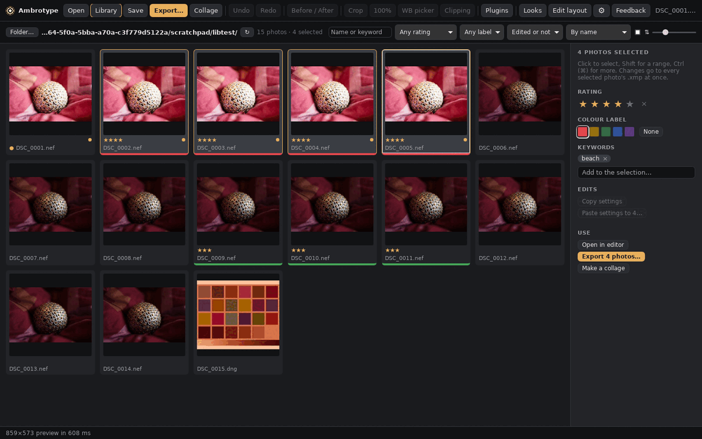

# The library

Status: built (2026-10-08). Asked for while preparing a 630-photo shoot: rate, label and tag many photos at once, and give a whole series the same edit.

## What it is

- **A folder as a grid.** The Library button (or G) swaps the editor for a grid of the open photo's folder, or any folder you choose. G again, Esc, Enter or a double-click goes back to the editor; Enter and double-click open that photo.
- **No catalogue.** Everything is read from and written to the photos' XMP sidecars, the files Lightroom and Bridge use. There is no database to import into, keep in sync or lose. The cost: one folder at a time, and a big folder is read when it opens (capture times come from the raw headers, read in parallel).
- **Thumbnails** are the camera's embedded previews first (quick). Photos with edits then get a render of their edit, one at a time, cached until the raw or its sidecar changes. The filmstrip does the same.

## What you can do

- **Find:** sort by name, capture time, rating or "edited first" (and reverse), filter by rating, colour label, flag and edited or not, and search names and keywords.
- **Select:** click, Shift-click for a range, Ctrl (⌘)-click for more; arrow keys move (Shift extends); Ctrl+A all shown, Ctrl+D none.
- **Rate, label and tag the selection:**
  - 1–5 rate and 0 clears; 6–9 set Red, Yellow, Green or Blue, and the same key again removes it (Lightroom's keys)
  - the panel shows what the selection shares: keywords on every photo (× removes from all) and on some of them (+ adds to the rest)
  - P flags a pick, X a reject, U removes the flag (Lightroom's keys); rejected photos are dimmed
  - written to each photo's `.xmp` at once: `xmp:Rating`, `xmp:Label`, `dc:subject`, and the flag (below)
- **Copy and paste an edit** (Lightroom's Sync): Copy settings on one photo (Ctrl+Shift+C), select others, Paste settings (Ctrl+Shift+V).
  - you choose the setting groups; crop, transform, masks and retouching are off by default
  - a ticked group becomes exactly the source's: settings the source doesn't have go back to their defaults
  - it runs as protocol commands: the open photo gets one undo step, the others their sidecars
- **Export the selection** with the export dialog's choices (sizes, borders, sharpening, metadata), one file each into a folder, each with its own edit, rating, label and keywords.
- **Make a collage** with the selection in the collage maker's tray.

The rating, label, flag and keyword keys work in the editor too, on the open photo. Its rating block has the label swatches and the flag buttons.

## Flags

Lightroom keeps pick and reject flags in its catalogue, not in sidecars, so there is no standard place for them. Ours:

- `amblib:Flag="pick"` or `"reject"`, in Ambrotype's library namespace (`http://ns.ambrotype.org/library/1.0/`). Lightroom ignores it and keeps it.
- Flags are separate from stars, as in Lightroom: a rejected photo keeps its stars.
- A rejected photo with no stars also gets `xmp:Rating="-1"`, the XMP way to say rejected, which Bridge and darktable read. A sidecar with `-1` from those apps opens as rejected.
- Rejected photos are not deleted or hidden; filter "Not rejected" leaves them out.

## Code

- `crates/amb-gui/src/library.rs`: listing, batch info changes, paste commands, batch export.
- `crates/amb-gui/ui/library.js`: the grid, selection, panel and keys.
- Labels and flags in `amb_protocol::sidecar::PhotoInfo` (`xmp:Label`, `amblib:Flag`); labels are exported as XMP (`amb_export::exif::Tags::label`), flags are not.

## Not yet

- Subfolders, several folders at once, collections, stacks.
- A compare view and a full-screen loupe in the library.
- A metadata panel (EXIF, caption, copyright) and editing keyword hierarchies.
- Undo for library changes. Ratings, labels and keywords are written straight away; pasted edits can be undone per photo in the editor.
- Background work: big pastes and exports run while you wait, with progress in the status bar.
