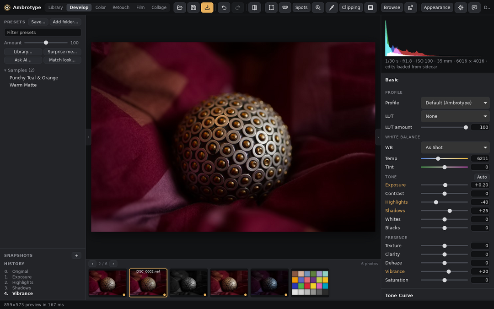
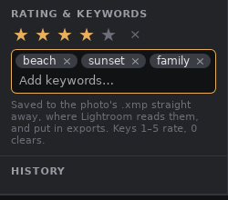
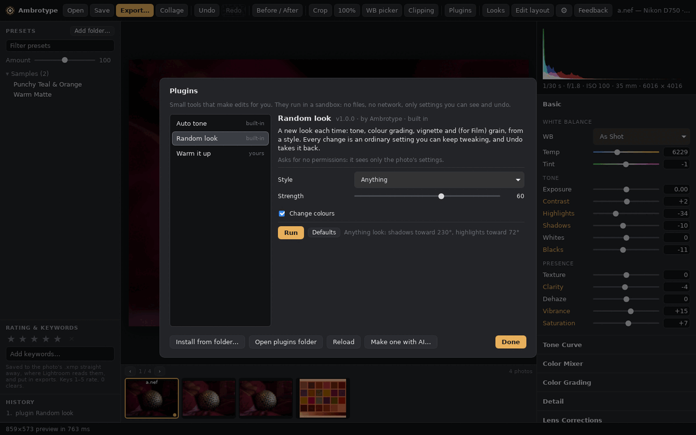
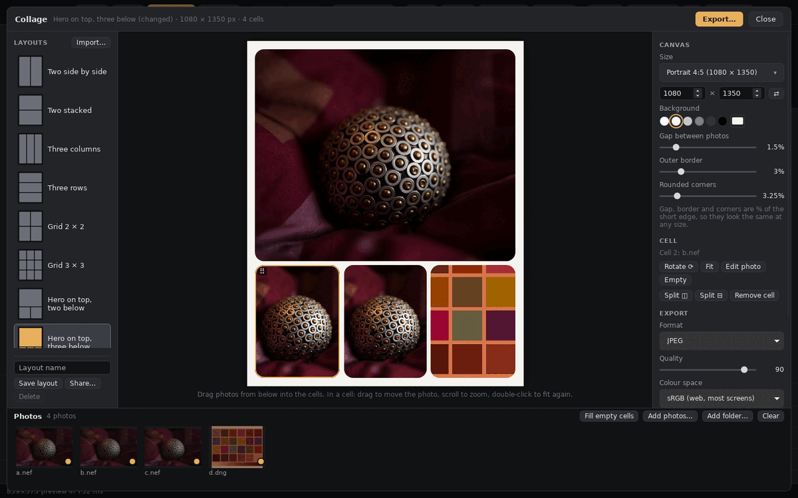
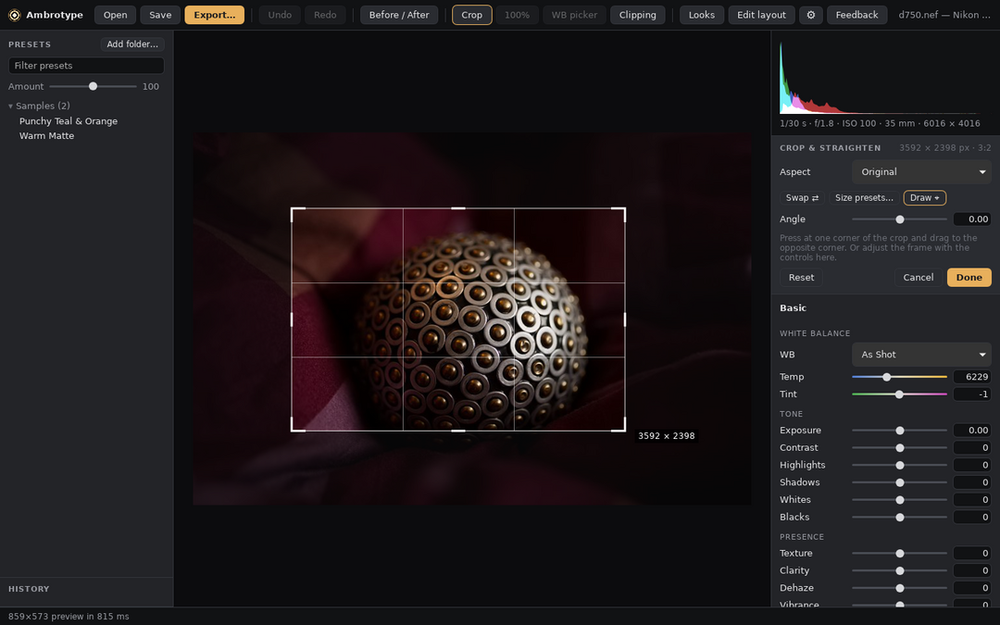
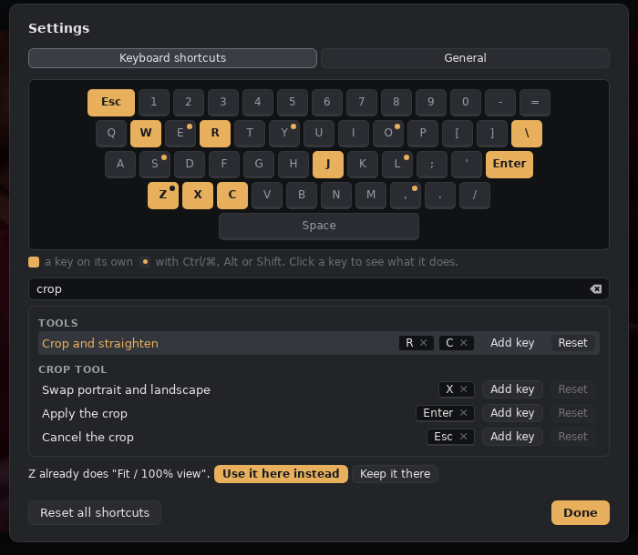

# Running Ambrotype on your desktop

## 0. Installers

When a release is published, its page on GitHub has installers: `.msi` or `-setup.exe` for Windows, `.dmg` for macOS, `.deb`, `.rpm` or `.AppImage` for Linux. They include the `amb` command-line tool. Until signing is set up, macOS and Windows warn that the app is from an unknown developer (macOS: right-click → Open). How releases are made: [releasing.md](releasing.md).

## 1. Install and build (Windows, macOS or Linux)
1. Install Rust from <https://rustup.rs>. On Windows, accept the Visual Studio C++ build tools prompt. On macOS, run `xcode-select --install` first.
2. Get the code:
   ```sh
   git clone https://github.com/shardpelt/Ambrotype.git
   cd Ambrotype
   git checkout claude/lightroom-alternative-scope-xlnf0p
   ```
   Already cloned under the old name (`flightbroom`)? GitHub redirects it, but you can point it at the new name:
   ```sh
   git remote set-url origin https://github.com/shardpelt/Ambrotype.git
   ```
3. Build and test:
   ```sh
   cargo test                      # all unit and integration tests should pass
   cargo build --release           # target/release/amb (CLI) and target/release/ambrotype (editor); .exe on Windows
   ```

## 2. Try it on your own photos
```sh
amb render photo.NEF out.jpg                       # any raw rawler supports (NEF, CR2/CR3, ARW, RAF, DNG, ...)
amb render photo.NEF out.jpg --preset look.xmp --amount 70
amb preset inspect look.xmp                        # what a preset contains and what we can't do yet
amb preset census "D:/Presets"                     # which settings your whole preset collection uses
```
Rendering covers the core Develop panels (white balance, Basic tone and presence, curves, HSL, Color Grading, Detail, Lens Corrections, Effects) plus film negatives, with a placeholder base look; nothing is fitted to Lightroom yet. The command lists what it skipped. If you can, send back the `amb preset census` output for your bought presets. It's only setting names and counts, no preset content, and it tells us what to build first.

## 3. Prepare the Lightroom kit (before subscribing)
Put the kit on the first Kingston SSD and the exports on the second one (see [lightroom-trial-plan.md](lightroom-trial-plan.md)).
```sh
amb sweep plan                                                # the 74 sweeps
amb sweep generate --out E:/kit --synthetic ramp,hue,edges,colorchecker
amb sweep generate --out E:/kit-raw --groups tone,white_balance,presence  D:/raws/*.NEF
```

## 4. Smoke test with Lightroom's 7-day free trial
1. Import a few files from `E:/kit` with **Add**.
2. Check three things:
   - The synthetic DNGs open, showing the profile "Ambrotype Linear ProPhoto".
   - The settings are applied: open `colorchecker__Exposure2012_p1.dng` and Exposure should read +1.00.
   - The proprietary-raw copies pick up their `.xmp` sidecars.
3. Note the Lightroom version and the process version it shows.
4. Report anything that doesn't import before starting the paid month.

## The desktop editor (GUI)

The editor is `crates/amb-gui` (Tauri 2). It is an early version: open a raw (or a JPEG, PNG, TIFF or WebP), edit with sliders and presets, before/after, undo/redo, save the XMP sidecar, export.

```sh
cargo run --release -p amb-gui                    # opens an empty window; drop a raw on it or press Ctrl+O
cargo run --release -p amb-gui -- photo.nef       # opens a photo straight away
```

- **Windows:** needs the WebView2 runtime (already part of Windows 10/11).
- **macOS:** works out of the box.
- **Linux:** install the WebKitGTK development packages first. On Ubuntu/Debian:
  ```sh
  sudo apt install libwebkit2gtk-4.1-dev libgtk-3-dev libsoup-3.0-dev libjavascriptcoregtk-4.1-dev librsvg2-dev libxdo-dev
  ```
- **Presets:** Lightroom's own preset folder is used automatically when it exists (`%APPDATA%\Adobe\CameraRaw\Settings` on Windows, `~/Library/Application Support/Adobe/CameraRaw/Settings` on macOS), plus `~/.local/share/ambrotype/presets`. "Add folder…" adds any other folder for the session. **Save…** keeps the photo's edit as your own one-click preset (without the crop, masks, retouching and geometry); it is listed under "Yours" and stored as a Lightroom-style `.xmp` in the app's settings folder (`presets/`), so Lightroom can import it too.
- **Black & White:** the Black & White panel turns the photo monochrome and sets how bright each colour becomes in grey (darker blue skies, lighter skin). Color Grading still applies on top, for sepia and other tints.
- **Filmstrip:** the other photos in the photo's folder (a JPEG shot together with a raw of the same name is shown once, as the raw) are shown under it, in name order, with their stars and a dot for photos with edits. Click one or use ← → to open it; your edits to the photo you leave are saved to its sidecar first. Thumbnails come from the preview the camera embedded (quick), and are cached; the open photo's thumbnail shows its edit. Files that can't be opened are marked and skipped.

  

- **Rating and keywords:** the stars and the keyword field (left column) are saved to the photo's `.xmp` straight away, in the fields Lightroom reads (`xmp:Rating`, `dc:subject`), and go into exported files: as XMP (read by Lightroom, Bridge, Apple Photos, digiKam and most websites), IPTC keywords in JPEGs, and EXIF Rating/XPKeywords for Windows. OpenEXR exports don't carry them yet. Keys 1–5 rate, 0 clears.

  

- **History:** the History panel (left column) lists every step since the photo was opened, from Original. Click a step to go back to just after it; the steps after it stay greyed and can be clicked to go forward again, until you make a new edit. Going back is itself undoable. History is saved in the photo's `.xmp` with its edits (when you move to another photo, save, export or close the app), so it is still there next time; if another app changes the edit in between, it starts again at Original ([design/library.md](design/library.md), History).
- **Snapshots:** the **+** next to Snapshots (above History) keeps the edit as it is now under a name, such as "Black and white" or "For print"; the name starts as the date and time. Click a snapshot to go back to it; that is one step in History, so it can be undone. Hover over one to update it with the current edit (↻), rename it (✎) or delete it (×). The one matching the current edit is bold. Snapshots are kept in the photo's `.xmp`, with the history.
- **Plugins:** the Plugins button (or Ctrl+Shift+P) runs small tools that make edits for you: **Auto tone**, **Random look** and **Film recipe**, a camera-style picture menu (film look, grain, white balance shift, highlight and shadow tone, and more) for typing in film recipes you find online ([ai/film-recipes.md](ai/film-recipes.md)). Each run is one step in History, so Undo takes it back. A plugin that wants to see the photo's histogram or camera facts asks first. Parameter sets can be saved as **recipes**, and **Save as preset…** keeps a plugin's result as a preset. **Install from folder…** adds one, **Share as pull request…** offers yours to the hub, and **Make one with AI…** writes instructions for your own AI assistant to build a new one. Writing plugins: [ai/plugins.md](ai/plugins.md).

  

- **Library:** the Library button (or G) shows the photo's folder as a grid. Sort, filter and search it; click, Shift-click and Ctrl/⌘-click to select many; then press 1–5 to rate them, 6–9 for a colour label, P or X to flag them as picks or rejects, or add keywords in the panel. **Copy settings** on one photo and **Paste settings** onto others to give a whole series the same edit, **Export…** the selection with the usual export choices, or **Make a collage** with it. Everything is saved to the photos' `.xmp` files, where Lightroom reads it. Enter or a double-click opens a photo.

  

- **Collage:** the Collage button (or C) opens the collage maker. Pick a layout, drag photos from the tray into the cells, then drag to move a photo in its cell, scroll to zoom, R to rotate. **Edit photo** opens a photo in the editor and **← Back to collage** returns. Set the size, background, gap, outer border and rounded corners on the right; split or remove cells, or press **Arrange freely** to move, resize, turn and overlap the photos by hand. **Save** keeps the whole collage in a `.ambcollage` file to reopen and edit later (Export can save one next to each image), and **Export pages…** puts a whole folder into pages of the layout.

  

- **Crop:** with no crop yet, the crop tool starts with a cross cursor: press at one corner and drag to the other, like a screenshot selection. Then adjust it with the handles.

  

- **Appearance:** the Appearance button picks a layout (Classic, Beginner, Compact, Big controls, Studio with knobs, Left-handed, Focus, Console, Two benches, Film lab) and a theme (Dark, Light, High contrast, Neutral grey, Cupertino Light and Dark, Swiss print, Telemetry, Stone, Graphite). Clone one to rename it or edit its colours; Share… and Import… move them between machines, and **Browse hub…** installs looks other people shared. **Edit layout…** in that dialog (or Ctrl+Shift+L) rearranges the screen in place: drag things to move them (onto the Add list to remove them), click one to change it, then Save. **Save this setup…** keeps the layout and theme together, exactly as they are, to come back to with Use; the setup from before your last change is kept for you. Your AI assistant can write new ones: [ai/ui-layouts.md](ai/ui-layouts.md).
- **Lens profiles** are found as for the CLI (lensfun database, your Adobe `.lcp` files; see docs/design/lens-corrections.md).
- **GPU:** the preview is developed on the graphics card when there is one (Metal on a Mac, Vulkan or DirectX elsewhere); the status bar then says "on the GPU", and hovering over it names the GPU, or says why a preview was made on the CPU (masks, defringe and camera profiles are CPU-only for now). Exports and the 100% view use the CPU. Set `AMB_GPU=off` to turn it off ([design/gpu.md](design/gpu.md)).
- **Keyboard:** every shortcut can be changed in **Settings** (the ⚙ button, or Ctrl+,). It shows them on a keyboard map and as a list, catches clashes, and keeps only your changes, so new defaults still arrive.

  

  The defaults:

  | Keys | Action |
  |---|---|
  | Ctrl+O | Open |
  | Ctrl+S | Save sidecar |
  | Ctrl+E | Export |
  | Ctrl+Z / Ctrl+Shift+Z or Ctrl+Y | Undo / redo |
  | `\` | Before/after |
  | Z, or click the photo | 100% view at that point; drag to pan |
  | W | White-balance picker: click something neutral grey or white |
  | J | Clipping overlay (red: clipped highlights, blue: crushed shadows) |
  | R | Crop and straighten. With no crop yet, the cursor is a cross: press at one corner and drag to the other. D draws a new one, X swaps the aspect, Enter applies, Esc cancels |
  | Esc | Leave the picker or crop tool |
  | ← → | Previous / next photo in the folder (edits are saved first) |
  | F | Show or hide the filmstrip |
  | Ctrl+Shift+P | Plugins |
  | C | Collage maker (in it: R turns the selected photo, Delete empties the cell, Ctrl+S / Ctrl+O save and open the collage, arrow keys nudge and `[` `]` restack free frames, Esc closes) |
  | 1–5, 0 | Rate the photo, or the selection in the library (0 clears) |
  | 6, 7, 8, 9 | Red, yellow, green, blue label (the same key again removes it) |
  | P, X, U | Flag as a pick, flag as rejected, remove the flag (not in the crop tool, where X swaps the aspect) |
  | G | Library grid / editor (from loupe, compare or survey: back to the grid) |
  | E, C, N | In the library: loupe, compare, survey |
  | Ctrl+Shift+I | Import photos from a card or folder |
  | B | Add the selection (or the open photo) to the last collection used |
  | Ctrl+' | Make a virtual copy (a second edit of the photo) |

- **Camera profiles:** the Profile menu (Basic panel) lists the `.dcp` profiles found for the photo's camera, in Camera Raw's profile folders and folders named in `AMB_DCP_DIRS`. Profiles you made with a ColorChecker work too.
  | Ctrl+Shift+C / Ctrl+Shift+V | In the library: copy one photo's settings / paste them onto the selection |
  | K | Jump to the keyword field (Enter or a comma adds a keyword) |
  | Ctrl+L / Ctrl+Shift+L | Appearance / Edit layout |
  | Ctrl+, | Settings and shortcuts |
  | Double-click a slider's knob or name | Reset it |
  | Shift while dragging a slider | Fine adjustment (a tenth as fast) |
  | Ctrl is Cmd on macOS | |

## macOS on Apple Silicon (M1 and later), with an external SSD

- **Format the SSD as APFS** (Disk Utility → Erase → APFS) if it stays with the Mac. exFAT works across Windows and Mac but is slower with many small files, has no permissions, and is less safe if unplugged mid-write. A build makes tens of thousands of small files.
- **Put the code and the build output on the SSD.** A debug `target/` grows to about 20 GB:
  ```sh
  cd /Volumes/<SSD>
  git clone https://github.com/shardpelt/Ambrotype.git && cd Ambrotype
  git checkout claude/lightroom-alternative-scope-xlnf0p
  cargo run --release -p amb-gui -- ~/Pictures/photo.nef
  ```
- **Spotlight:** exclude the `target/` folder (System Settings → Spotlight → Search Privacy) so it doesn't index build files.
- **Always use `--release` to judge speed.** A debug build is about 10× slower (the 1:1 view took about 33 s in debug).
- The app isn't signed or notarised yet, so run it with `cargo run` (or open the built binary from Terminal) rather than by double-clicking a copied app.

## Working with an AI agent locally

The cloud sessions on claude.ai/code run in a container that can't see your drives, Lightroom or your photos. For anything that touches them (the sweep kit, the Lightroom batches, comparing renders), run the agent on your own Mac. The repo itself is the hand-off: [AGENTS.md](../AGENTS.md) (also read as `CLAUDE.md`) and [NEXT.md](NEXT.md) tell a fresh session where things stand.

1. **Install Claude Code** (see <https://code.claude.com/docs> for the current installer), or use the Code tab of the Claude desktop app and pick the repo folder on the SSD.
2. **Start it in the repo:**
   ```sh
   cd /Volumes/<SSD>/Ambrotype
   claude
   ```
   It can now build, run the app, read your raws and Lightroom exports, and run `amb` on them. It asks before running commands unless you allow them.
3. **Steer it from your phone (optional):** run `claude remote-control` in the repo folder instead. The session runs on the Mac and shows up in the Claude app, so you can follow and answer it away from the desk.
4. **Choosing models:** use `/model` to switch, for example a stronger model in plan mode (Shift+Tab) for planning, then the execution model to build. A subagent file in `.claude/agents/` can pin its own model, for example a planner.
5. **Several agents in the background:** [herdr](https://github.com/ogulcancelik/herdr) is a terminal multiplexer for coding agents. It keeps each agent (Claude Code, Codex, …) in its own pane, shows which ones are working, blocked or done, and keeps them running when you close the terminal. For parallel work on this repo:
   - Give each agent its own git worktree (`git worktree add ../amb-<task> -b <task>`).
   - Give each agent its own `CARGO_TARGET_DIR` on the SSD.
   - Merge the branches when they're done.
6. **Keep the Mac awake for long runs.** Background agents (herdr's included) stop when the Mac sleeps. Plug in, and run `caffeinate -dis` in a terminal for as long as the batch runs. A MacBook only stays awake with the lid closed when it's on power and connected to an external display.
7. **Local models (optional):** a quantised Qwen coder model through Ollama or LM Studio (MLX builds are fastest on Apple Silicon) can handle small, cheap tasks. On an 8–16 GB M1, stay around 7–14B parameters. That's too small to drive work on this codebase on its own.

### The Lightroom trial batches with a local agent

The agent can't click through Lightroom for you, but it can do everything around it:

- **Before importing:** generate the sweep kit onto the SSD (`amb sweep generate …`, see [lightroom-trial-plan.md](lightroom-trial-plan.md)) and check that the counts and folder layout match the run sheet.
- **In Lightroom (you):** import the folder, select all, and export with the saved export preset. That's a few clicks per batch, however many images it holds.
- **After exporting:** the agent checks that every expected export exists, then renders the same files with `amb` and compares them, and fits the model constants from the differences.


